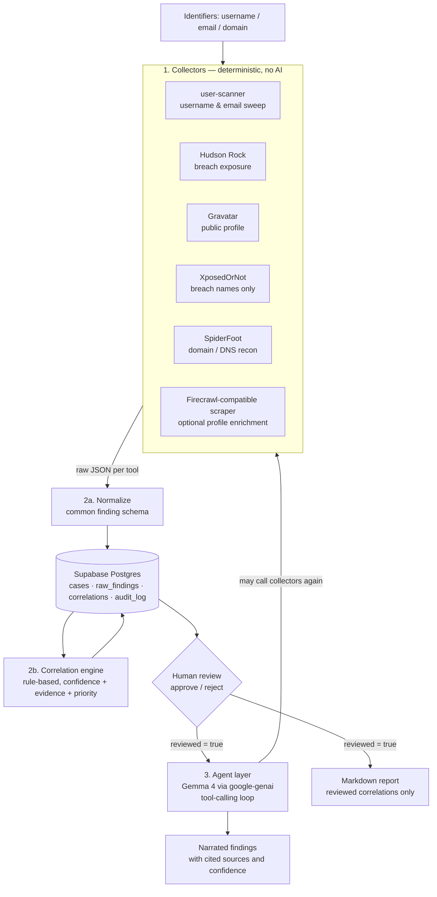

# Sherlock

**An OSINT investigation agent that keeps the facts in code and the narration in the LLM.** Deterministic collectors gather public data, a rule-based correlation engine links it with confidence scores and evidence, a human reviews each link, and only then does a Gemma-powered agent narrate what was found.


-4285F4?logo=google&logoColor=white)


---

## Responsible use

Sherlock is built for **self-exposure checks, security research and authorized investigations only**. The ethics rules in [`plan.md`](plan.md) apply to every collector and data source in the project:

**Allowed**
- Public social and professional profile data (usernames, bios, public posts)
- Breach **exposure confirmation** ("this email appeared in Breach X") without reconstructing personal records
- Public government and registry data (company registries, court records, open data portals)
- Data the target published about themselves

**Not allowed**
- Any source that resolves a phone number or national ID (e.g. CNIC) to an identity or address
- Any source built from leaked or unauthorized government or telecom databases
- Any correlation presented as certain fact instead of confidence-scored

These rules are enforced in the code as well as the docs:
- Breach data is stored as **exposure metadata only** (breach name, date, data categories), never raw breach contents.
- The agent's [system prompt](agent/system_prompt.md) restricts it to the provided tools, allows it to present only **human-reviewed** correlations, requires honest confidence levels and source citations, forbids phone/ID-to-identity resolution, and asks the user to confirm a legitimate purpose when the framing is unclear.
- Every collector run, correlation, agent call and report is written to an `audit_log` table.
- Cases can be deleted on request (`DELETE /cases/{id}`, cascading to findings and correlations).

Ambiguous new data sources get flagged for human review before they are wired in. Test on your own accounts, not on other people's.

---

## How it works

The project has three layers, and they stay separate so the LLM cannot invent facts:



1. **Collectors** wrap existing open-source OSINT tools and return normalized findings with `status: found | not_found | error`. One failing tool never aborts a run.
2. **Correlation** (`core/correlate.py`) applies deterministic rules: `username_reuse`, `shared_bio_text`, `shared_display_name`, `shared_email`, `shared_email_platform`, `shared_url`, `shared_external_handle` and `breach_overlap`. Each correlation carries a confidence score, human-readable evidence, and `priority = confidence × platform reach` for triage order.
3. **Review**: correlations start as `reviewed = false`. A person approves or rejects each one in the browser before anything downstream can cite it.
4. **Agent** (`agent/orchestrator.py`) runs a custom tool-calling loop over five tools (`run_username_scan`, `run_email_scan`, `run_domain_scan`, `get_case_findings`, `get_reviewed_correlations`) and narrates only what the reviewed data supports.
5. **Report** (`core/report.py`) builds a Markdown report from findings plus reviewed correlations, ordered by priority.

---

## Features

- **Multi-identifier cases**: investigate usernames, emails and domains together in one case.
- **Username and email sweeps** across the platforms covered by [`user-scanner`](https://github.com/kaifcodec/user-scanner), plus Hudson Rock exposure checks for both, and Gravatar profile lookup for emails.
- **Breach exposure checks** via [XposedOrNot](https://github.com/XposedOrNot/XposedOrNot-API) (no API key, breach names only).
- **Domain reconnaissance** through a running [SpiderFoot](https://github.com/smicallef/spiderfoot) server's HTTP API.
- **Pivot extraction** (`core/extract.py`): pulls emails, URLs and cross-platform handles out of bios and metadata to suggest the next scan.
- **Username and email variations** (`core/variations.py`): the LLM picks which transformations a real person would use, and deterministic code applies and validates them. Variations can be scanned and re-correlated in one call.
- **Human-in-the-loop review queue**, ordered by priority.
- **Agent chat per case**, constrained to reviewed correlations and cited sources.
- **Optional profile enrichment** through a Firecrawl-compatible scraping API (returns 503 with a hint when not configured).
- **Background scan jobs** with status polling for long-running username/email scans.
- **Full audit trail** and case deletion.
- **Swappable LLM**: `agent/llm.py` defines an `LLMClient` interface, so changing models touches one file.

---

## Tech stack

| Layer | Technology |
|---|---|
| Language | Python 3.11 |
| Collectors | `user-scanner`, XposedOrNot API, Hudson Rock, Gravatar, SpiderFoot (HTTP API), optional Firecrawl-compatible scraper |
| HTTP client | `httpx` |
| Storage | Supabase (hosted Postgres, JSONB) via `supabase-py` |
| LLM | Gemma 4 26B A4B (`gemma-4-26b-a4b-it` by default) through the Gemini API with `google-genai`, using native function calling |
| Agent loop | Custom tool-call → execute → feed-back loop (no framework) |
| API | FastAPI + Uvicorn |
| Frontend | Next.js 16 (App Router), React 19, TypeScript, Tailwind CSS, shadcn/ui-style Radix components, `react-markdown` |
| Packaging | `uv` (`pyproject.toml` + `uv.lock`), exported to `requirements.txt` |
| Deployment | Render (API) via `render.yaml` |

---

## Project structure

```
sherlock/
├── agent/
│   ├── llm.py                  # LLMClient interface + GeminiLLM (google-genai) — model swap point
│   ├── orchestrator.py         # Agent tool-calling loop + tool schemas
│   └── system_prompt.md        # Ethics-constrained system prompt
├── api/
│   ├── main.py                 # FastAPI app, CORS, /health
│   ├── jobs.py                 # In-memory background job tracking
│   ├── schemas.py              # Pydantic models
│   └── routers/                # cases, correlations, audit
├── core/
│   ├── collectors/             # user-scanner, XposedOrNot, SpiderFoot, scraper wrappers
│   ├── config.py               # Env loading and rate limits
│   ├── normalize.py            # Per-collector output → common finding schema
│   ├── correlate.py            # Deterministic correlation rules + priority
│   ├── extract.py              # Pivot extraction (emails, URLs, handles)
│   ├── variations.py           # Username / email variation generation
│   ├── pipeline.py             # collect → upsert → correlate
│   ├── report.py               # Markdown report from reviewed data
│   ├── db.py                   # Supabase wrapper
│   └── schema.sql              # Database DDL
├── frontend/                   # Next.js app: cases, investigation, review, report, audit
├── tests/
│   ├── test_api.py             # End-to-end API smoke test
│   └── test_agent.py           # Agent loop + chat endpoint with a mock LLM
├── cli.py                      # Headless collector runner
├── plan.md                     # Design doc, ethics bar, build phases
├── pyproject.toml / uv.lock
├── requirements.txt
└── render.yaml
```

---

## Getting started

### Prerequisites
- Python 3.11+ and [uv](https://docs.astral.sh/uv/) (or `pip`)
- Node.js for the frontend
- A [Supabase](https://supabase.com) project
- A Google AI Studio / Gemini API key for the agent and variation features
- Optional: a running SpiderFoot server for domain scans, and a Firecrawl-compatible API key for enrichment

### 1. Configure environment

```bash
cp .env.example .env
```

Fill in the variables (names from `.env.example`):

| Variable | Purpose |
|---|---|
| `MODEL_NAME` | LLM model id (defaults to `gemma-4-26b-a4b-it`) |
| `GOOGLE_API_KEY` | Gemini API key used by `google-genai` |
| `SUPABASE_URL` | Supabase project URL |
| `SUPABASE_SERVICE_KEY` | Supabase service key (server side only, never sent to the frontend) |
| `SPIDERFOOT_URL` | SpiderFoot server URL (domain scans are skipped when unset) |
| `SF_SCAN_TIMEOUT` | SpiderFoot scan timeout in seconds |
| `SCRAPING_API_URL` | Optional Firecrawl-compatible API base URL |
| `SCRAPING_API_KEY` | Optional key that enables profile enrichment |

The API also reads `FRONTEND_ORIGINS` (comma-separated) to allow extra CORS origins beyond `localhost:3000`.

### 2. Create the database

Run [`core/schema.sql`](core/schema.sql) once in the Supabase SQL editor. It creates `cases`, `raw_findings`, `correlations` and `audit_log`.

### 3. Install dependencies

```bash
uv sync
# or
pip install -r requirements.txt
```

### 4. Run the CLI (collectors only, no database)

Writes normalized JSON to `out/`:

```bash
uv run python cli.py scan-username <username>
uv run python cli.py scan-email <email>
uv run python cli.py breach <email>
uv run python cli.py scan-domain <domain>   # needs SPIDERFOOT_URL
```

### 5. Run the API

```bash
uv run uvicorn api.main:app --reload --port 8000
```

Interactive OpenAPI docs are served at `http://localhost:8000/docs`, and a health check at `/health`.

### 6. Run the frontend

```bash
cd frontend
npm install
echo "NEXT_PUBLIC_API_URL=http://localhost:8000" > .env.local   # optional, this is the default
npm run dev
```

Open `http://localhost:3000`.

### 7. Run the tests

The tests are smoke scripts that use FastAPI's `TestClient` against a **real Supabase project** (configured in `.env`). Network-bound collectors are skipped and the agent test uses a mock LLM, so no LLM tokens are spent. Each test cleans up the case it creates.

```bash
uv run python tests/test_api.py
uv run python tests/test_agent.py
```

---

## Deployment

[`render.yaml`](render.yaml) defines a Render web service (`sherlock-api`) on the free plan:

- **Build:** `pip install -r requirements.txt`
- **Start:** `uvicorn api.main:app --host 0.0.0.0 --port $PORT`
- **Health check:** `/health`
- **Secrets set in the Render dashboard:** `SUPABASE_URL`, `SUPABASE_SERVICE_KEY`, `GOOGLE_API_KEY`, optional `SCRAPING_API_KEY`
- **Config:** `PYTHON_VERSION`, `MODEL_NAME`, `SCRAPING_API_URL`, and `FRONTEND_ORIGINS` (set to your deployed frontend origin for CORS)

`.renderignore` keeps the frontend, tests and local scripts out of the API deploy. The Next.js frontend is deployed separately, with `NEXT_PUBLIC_API_URL` pointing at the Render service.

---

## Author

**Rao Ali Hassan**
- LinkedIn: [ali-hassan-36a43b318](https://www.linkedin.com/in/ali-hassan-36a43b318/)
- GitHub: [@MaximumCell](https://github.com/MaximumCell)
