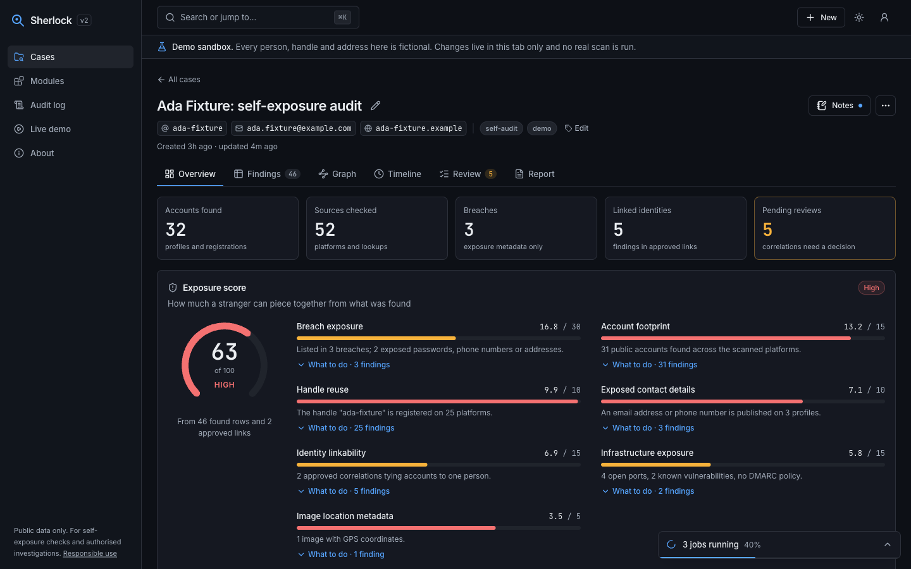
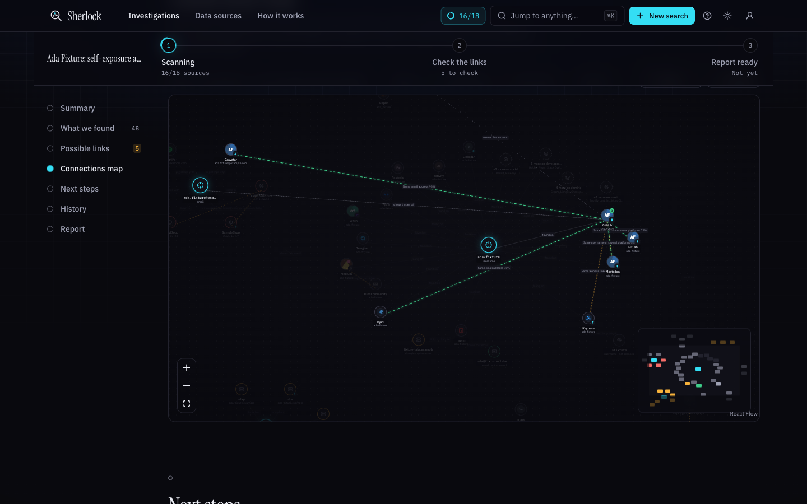
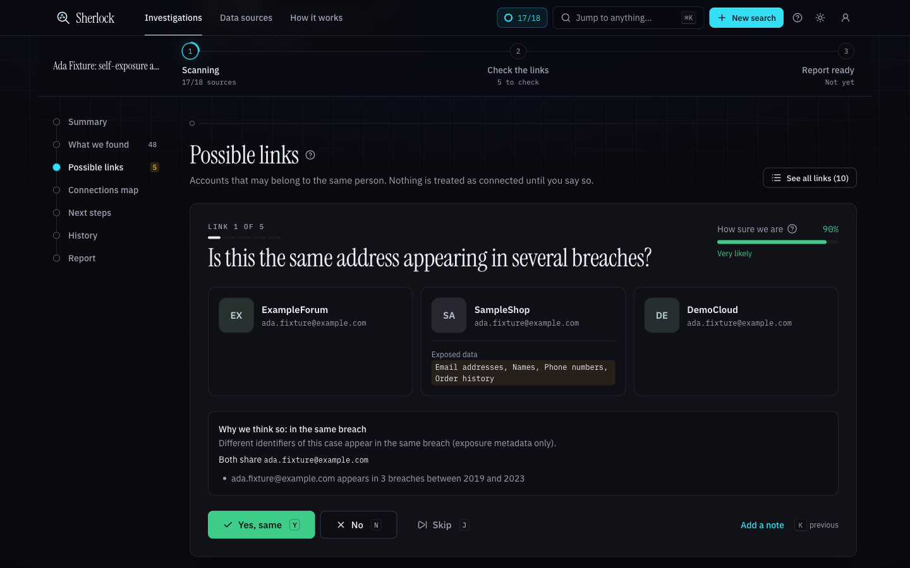
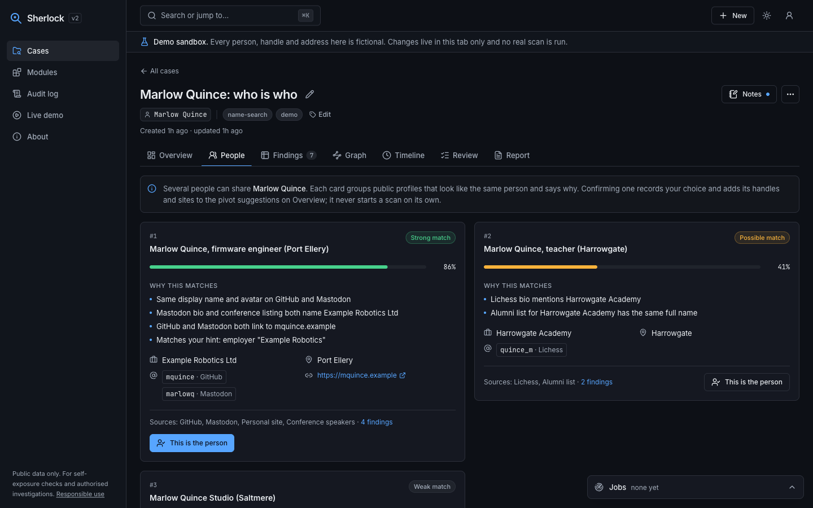
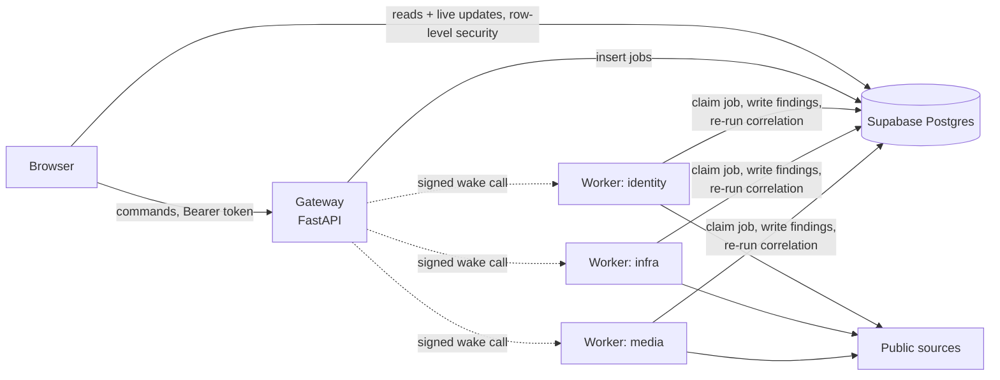

# Sherlock

**An OSINT investigation platform that keeps the facts in code and a human in the loop.** Give it a username, email, domain, IP, image, phone number, wallet address or a person's name. Deterministic collectors gather public data, a rule engine links it with confidence scores and evidence, and a person approves or rejects every link before it counts.

It runs entirely on free tiers: four sleeping services on Render, Supabase Postgres and Vercel.



| Entity graph | Review queue | Name search |
|---|---|---|
|  |  |  |

The screenshots show the bundled demo case. Every person, handle and address in it is fictional.

## Responsible use

Sherlock is for **self-exposure checks, security research and authorised investigations**.

- Public data only. Breach results are exposure metadata (breach name, date, data categories), never records or passwords.
- Running a search requires a free signed-in account (the live demo does not); every search is written to the audit log.
- Every search is logged (what was searched, when, and an anonymised origin, never an IP address) and the log is kept for 90 days. To prevent misuse the operator can review searches and their results, read-only; each review is recorded in that case's history.
- It does not look up who owns a phone number or national ID, does not do face recognition, and does not collect home addresses or family relationships. People-search and data-broker sites are excluded from results.
- Correlations are confidence scores with evidence, never statements of fact, and nothing is treated as confirmed until a person approves it.

## Architecture



| Part | Where | Role |
|---|---|---|
| `apps/web` | Vercel | Next.js 16 app. Reads straight from Supabase, so pages load even while the backend sleeps. |
| `services/gateway` | Render (free) | Validates commands, checks ownership, rate-limits, enqueues jobs, wakes workers. |
| `services/worker` | Render (free) x 3 | One codebase deployed once per queue: `identity`, `infra`, `media`. |
| `packages/core` | shared library | Models, storage layer, module registry, correlation engine, scoring, name resolution. |
| `supabase/migrations` | Supabase | Schema, job-queue function, row-level security. |

### Designed around the free tier

Render's free plan gives one shared pool of 750 instance-hours a month, 512 MB and 0.1 CPU per service, a 15-minute idle sleep, and no background workers. The design follows from that:

- **Jobs live in Postgres, not in memory.** Workers claim them with `FOR UPDATE SKIP LOCKED`, heartbeat while running, and retry up to three times. A job whose worker went to sleep or crashed is requeued by the next claim.
- **Services sleep and are woken on demand.** After enqueueing, the gateway sends an HMAC-signed `POST /wake` to the worker for that queue. There are no keep-alive pings: four services kept awake would use the month's hours in about eight days.
- **Reads never touch Render.** The browser reads from Supabase under row-level security and gets new findings through Realtime, so a cold backend delays a scan by about a minute but never blocks a page.
- **Every visitor is isolated.** Each Supabase session (anonymous for browsing and the demo, signed in to search) only reads its own cases. Searches are limited per account (one unfinished search at a time, 3 per 10 minutes), per network (5 per 10 minutes, 30 a day, by hashed IP) and globally per day, and refused with a 503 while a queue is backed up.
- **Workers run a few jobs at once.** Each worker runs up to 3 jobs (most wait on the network), never two memory-heavy ones (WhatsMyName, user-scanner) together, and claims round-robin across searches so one visitor's 19 jobs cannot hold up everyone else.

## How an investigation works

1. **Create a case** with one or more targets.
2. **Modules run as jobs**, one per data source, so one failing source never loses the rest.
3. **Findings are stored** under a stable key, so rescans update rows instead of duplicating them.
4. **The correlation engine** turns findings into typed facts and links them: shared email, shared link, cross-platform handle reference, matching bio, matching display name, breach overlap, matching profile picture (perceptual hash).
5. **You review** each link. Decisions survive rescans, and a rejected link is not proposed again.
6. **Pivot suggestions** offer newly discovered emails and handles as the next scan. Nothing runs without you starting it.
7. **Exposure score** (0 to 100) and the Markdown report are built from reviewed data, with a remediation step for each factor.

**Name search** adds one step: results from several sources are clustered into distinct people, each with a score and the reasons behind it, and you pick the right person before anything else happens.

## Data sources

38 modules, each a small class registered in a plugin registry (`packages/core/sherlock_core/modules`).

| Target | Sources |
|---|---|
| Username | WhatsMyName dataset (690 sites, own async engine), user-scanner sweep, GitHub, profile data from Bluesky, Mastodon, GitLab, Keybase, Hacker News, DEV, Docker Hub, npm, Codeberg, Lichess, Chess.com, Codeforces, Hugging Face, public activity-time fingerprint |
| Email | Gravatar, GitHub commits, breach exposure (XposedOrNot, LeakCheck), infostealer exposure (Hudson Rock), account sweep |
| Domain / IP | Certificate transparency (crt.sh), RDAP, DNS records with SPF and DMARC checks, Shodan InternetDB, Wayback Machine, RIPEstat |
| Image (link or uploaded photo) | Metadata and perceptual hash, Google Lens via SerpApi (needs `SERPAPI_KEY`), ready-made search links |
| Phone | Region, carrier and line type only |
| Wallet | Bitcoin and EVM balance and transaction summary |
| Name | OpenAlex, ORCID, Wikidata, GitHub user search, web search, UK Companies House (needs `COMPANIES_HOUSE_API_KEY`) |

Modules that need a missing key report themselves unavailable and are skipped. `GET /modules` and the Modules page list the live catalogue.

## Run it locally

Requirements: [uv](https://docs.astral.sh/uv/), Node 22, Docker (optional), a Supabase project.

```bash
# 1. Database: run supabase/setup.sql in the Supabase SQL editor (existing database: run the migrations it does not have yet,
#    e.g. supabase/migrations/0004_uploads.sql), then enable Anonymous and Email sign-ins under Authentication.

# 2. Backend
cp .env.example .env            # fill in SUPABASE_URL, SUPABASE_SERVICE_KEY, INTERNAL_SECRET
docker compose up --build       # gateway on :8000, workers on :8101-8103

# 3. Web app
cd apps/web
cp .env.example .env.local      # Supabase URL, anon key, NEXT_PUBLIC_API_URL=http://localhost:8000
npm install && npm run dev
```

To look at the app with no backend at all:

```bash
cd apps/web && NEXT_PUBLIC_FIXTURES=1 npm run dev
```

Fixture mode needs no account. Add `?signin=required` to any URL to see the signed-out "sign in to search" flow, and search the usernames `demo-busy`, `demo-limit`, `demo-running` or `demo-queued` to see the refusals and the waiting state.

## Tests

```bash
uv sync && uv run pytest         # 630 backend tests, all offline (in-memory store, recorded responses)
uv run ruff check .
cd apps/web && npm run lint && npm run typecheck && npm test
```

CI runs all of this on every pull request.

## Deploy

- **Supabase:** run the migrations (before deploying code that needs them), enable Anonymous sign-ins (browsing and the demo) and Email sign-in (searching; Google optional).
- **Render:** New, then Blueprint, and select this repo. [`render.yaml`](render.yaml) creates the gateway and three workers with a shared generated secret. Enter the Supabase URL and service key when asked.
- **Vercel:** root directory `apps/web`, with `NEXT_PUBLIC_SUPABASE_URL`, `NEXT_PUBLIC_SUPABASE_ANON_KEY` and `NEXT_PUBLIC_API_URL`.
- **GitHub secrets** `SUPABASE_URL` and `SUPABASE_ANON_KEY` let the twice-weekly keepalive workflow stop the free Supabase project from pausing.

## Photo uploads

The start screen takes a photo for an image search (drop, paste or "Upload a photo"; JPEG, PNG, WebP or GIF up to 8 MB; sign-in required). It goes to the private Supabase Storage bucket `media` under `uploads/<user id>/<random id>.<ext>`, readable only by its uploader; the search runs on `storage://media/uploads/...`, which the gateway accepts only from that user. Workers read it with the service key; search engines get a signed link that expires after an hour. The photo is deleted with its investigation. Matches mean the same picture, never the same face.

Run [`supabase/migrations/0004_uploads.sql`](supabase/migrations/0004_uploads.sql) once (it makes the bucket private, sets the limits and adds the per-user policies). Until it has run, uploads fail with "Photo upload is not set up on this server yet"; image search by link keeps working.

## Operator panel

`/admin` shows the person running a deployment what visitors search and where from: searches per day by outcome, a live feed (including refused searches), visitors with plain-English warning signs (bursts, many different targets, repeated limits, shared origins), and the controls to act: block or unblock a session, pause all searches, remove a case. Targets can be blurred with "Hide targets". Origins are stored as a keyed hash, never as an IP address; search records are deleted after 90 days. Refusals show with plain labels (too many at once, search still running, server busy, needed sign-in), and "Hit the burst limit" is a warning sign. "View case" opens any visitor's case read-only for abuse review (`/admin/cases/<id>`); every opening is recorded in that case's own history, which its owner sees.

Preview it with invented data at `/demo/admin` (works in every mode), or run the web app with `NEXT_PUBLIC_FIXTURES=1` and open `/admin`.

To use it for real:

1. In the Supabase SQL editor run [`supabase/migrations/0002_admin.sql`](supabase/migrations/0002_admin.sql) (a new project can run `supabase/setup.sql`, which includes it).
2. In Supabase, enable **Email** sign-in under Authentication, Sign In / Providers (keep email confirmation on: only a confirmed email counts).
3. Set `ADMIN_EMAILS` on the gateway (Render: sherlock-gateway, Environment; locally `.env`) to your email, comma-separated for several.
4. Sign in on the site with that email (magic link), then open the account menu: "Operator panel".

| Variable | Where | Purpose |
|---|---|---|
| `ADMIN_EMAILS` | gateway | Comma-separated operator emails (confirmed sign-in). Empty: nobody can open `/admin`. |
| `INTERNAL_SECRET` | gateway, workers | Also the key of the origin hash. |
| `REQUIRE_SIGN_IN` | gateway | `true` (default): searching needs a signed-in account. `false` lets anonymous sessions search again (name search always needs an account). Mirror it in the web app with `NEXT_PUBLIC_REQUIRE_SIGN_IN`. |
| `SEARCHES_PER_SESSION_PER_10M`, `SEARCHES_PER_ORIGIN_PER_10M`, `SEARCHES_PER_ORIGIN_PER_DAY` | gateway | Burst and per-network limits (3, 5, 30). The operator is exempt. |
| `ACTIVE_SEARCHES_PER_SESSION`, `QUEUE_BACKLOG_MAX` | gateway | One unfinished search per session; refuse new searches while a queue holds more than 80 queued jobs (applies to the operator too). |
| `WORKER_CONCURRENCY`, `ENRICH_CONCURRENCY` | workers | Jobs at once per worker (3, at most one heavy) and shared preview/avatar downloads (4). |

## Known limits

- The first scan after an idle period waits about a minute for Render to wake the services.
- One worker per queue on 0.1 CPU: when several people search at once, later searches wait. The scan panel then says "Waiting for other searches to finish · N ahead of you" with a rough estimate. Memory under 3 concurrent jobs is bounded by design (one heavy module at a time, shared download limit) but was not measured on a 512 MB instance.
- Free sources rate-limit and occasionally block datacentre IPs; a blocked source shows as an error finding and the rest of the scan continues.
- Existence checks say an account exists, not who owns it. Links come from profile data, so sparse profiles produce few correlations.
- Keyless web search for name lookups is best-effort. A SerpApi key (250 free searches a month) makes it reliable.

## Project layout

```
apps/web                 Next.js app
services/gateway         API gateway
services/worker          Queue worker
packages/core            Shared library and its tests
supabase/migrations      Database schema
docs/CONTRACTS.md        Interfaces between the parts
```

## Author

**Rao Ali Hassan** · [LinkedIn](https://www.linkedin.com/in/ali-hassan-36a43b318/) · [GitHub](https://github.com/MaximumCell)
