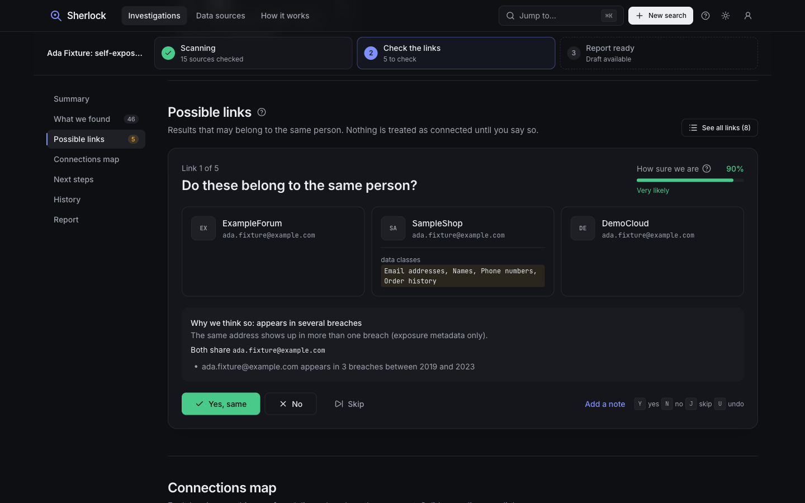
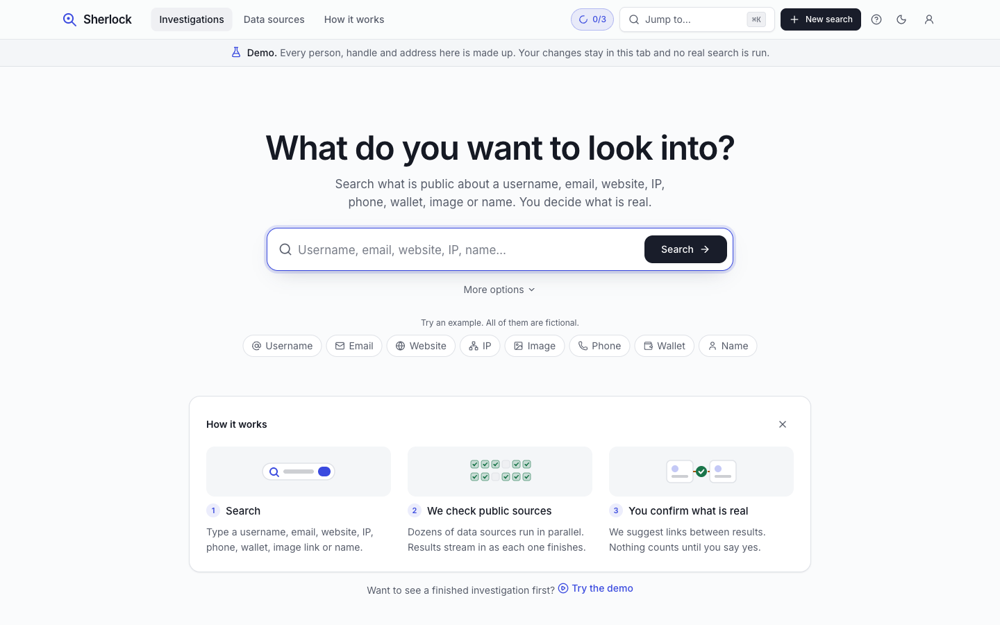
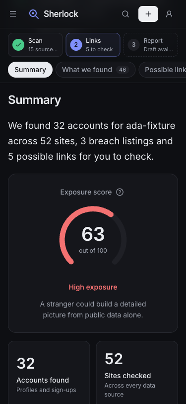

# Sherlock web

The Next.js app for Sherlock v2. One search box on the start screen, then one guided page per
investigation: a three-step progress rail (Scanning → Check the links → Report ready) over
Summary, What we found, Possible links, People, Connections map, Next steps, History and Report.
Plain language by default; the **Advanced** switch (per browser) reveals data-source ids, queues,
attempts, finding keys, rule ids and raw JSON. `/demo` runs a short guided tour.

Pages are client-rendered data views behind a thin server shell:
reads come straight from Supabase under row-level security (with Realtime), commands go to the
gateway. No page ever waits on the gateway during render, so a sleeping scan service cannot break it.

## Environment

Copy `.env.example` to `.env.local`.

| Variable | Purpose |
|---|---|
| `NEXT_PUBLIC_SUPABASE_URL` | Supabase project URL (reads, auth, Realtime) |
| `NEXT_PUBLIC_SUPABASE_ANON_KEY` | Supabase anon key |
| `NEXT_PUBLIC_API_URL` | Gateway base URL for commands (default `http://localhost:8000`) |
| `NEXT_PUBLIC_FIXTURES` | `1` serves everything from the bundled fictional demo case |

If the Supabase variables are missing the app shows a banner and falls back to fixture data.

## Scripts

| Script | What it does |
|---|---|
| `npm run dev` | Dev server |
| `npm run build` / `npm start` | Production build and server |
| `npm run lint` | ESLint (flat config, Next + TypeScript rules) |
| `npm run typecheck` | `tsc --noEmit` |
| `npm test` | Vitest + Testing Library |
| `npm run format` | Prettier |

## Fixture mode

```bash
NEXT_PUBLIC_FIXTURES=1 npm run dev
```

Every screen then works with no backend. To run a second dev server next to one that is already
running (Next allows one per build folder), give it its own folder:
`NEXT_DIST_DIR=.next-demo NEXT_PUBLIC_FIXTURES=1 npx next dev -p 3417`. The data layer has one interface, `DataSource`
(`lib/data/types.ts`), with two implementations: `lib/data/supabase.ts` (Supabase + gateway) and
`lib/data/fixtures/` (in memory). The fixture source accepts every command, simulates job progress
with timers and emits the same change events as Supabase Realtime, so the UI code path is identical.
The `/demo` route always uses it, whatever the environment.

All fixture data is fictional: the handle `ada-fixture`, the name-search subject "Marlow Quince",
reserved `.example` domains, RFC 5737 addresses. Fixture mode also scores exposure locally
(`lib/data/fixtures/exposure.ts`) so the score reacts to scans and link decisions.

## Screenshots

| Start screen | Investigation |
|---|---|
|  |  |
| **Connections map** | **Possible links** |
|  |  |
| **People (name search)** | **Light theme, first visit** |
|  |  |
| **Mobile (375 px)** | |
|  | |

## Gateway calls

All from the browser with `Authorization: Bearer <Supabase access token>`, retried with backoff
while the service wakes (a "Waking the scan service…" notice appears after 3 s).

| Call | Used by |
|---|---|
| `GET /modules` | Data sources page, source names (falls back to the bundled catalogue) |
| `POST /cases`, `PATCH /cases/{id}`, `DELETE /cases/{id}` | Search box (with a source subset: create, then scan), header menu |
| `POST /cases/{id}/scan` (`hints` for `type: "name"`) | Add another target, search again, suggested next searches, retry a source |
| `POST /cases/{id}/jobs/{job}/cancel`, `POST /cases/{id}/wake` | Scan progress (stop), stuck-job wake (every 20 s at most) |
| `POST /cases/{id}/findings/{fid}/curate`, `POST /correlations/{id}/review` | Pin, Possible links |
| `GET /cases/{id}/report` | Report section (fetched when it scrolls into view) |
| `GET /cases/{id}/exposure` | Summary score and "What to do" |
| `GET /cases/{id}/candidates`, `POST /cases/{id}/candidates/{cid}/confirm` | People section (404 shows "not available yet") |

## Layout

```
app/                  routes (thin server shells) + error / not-found / loading
components/ui         shadcn/Radix primitives
components/shell      top bar, command palette, help and account menus, scan indicator, banners
components/search     the smart search box (type detection, acknowledgement, options)
components/start      start screen: hero search, examples, how it works, recent investigations
components/case       the investigation page: header, progress rail, section nav, and one folder
                      per section (scan, summary, found, links, people, map, next, history, report)
components/tour       first-run coach-mark tour of the demo
lib/types.ts          mirrors packages/core/sherlock_core/models.py
lib/data              DataSource interface, Supabase and fixture implementations, gateway client
lib/query             TanStack Query hooks, mutations and Realtime cache patching
lib/graph             graph model + deterministic radial layout
lib/detect-target.ts  guesses the target type from free text (start screen chip)
lib/case-progress.ts  scan progress, the three rail steps, status lines; also case-summary,
                      finding-groups, remediation, sections (old ?tab= links map onto sections)
lib/finding-extras.ts parsers for module-specific finding shapes (DNS, services, wallet, image,
                      activity); unknown keys fall back to a generic key/value view
```
