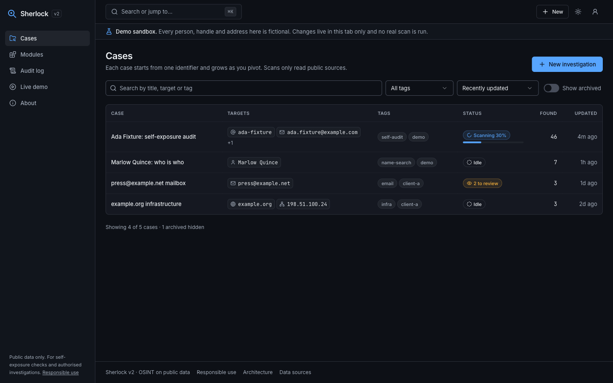
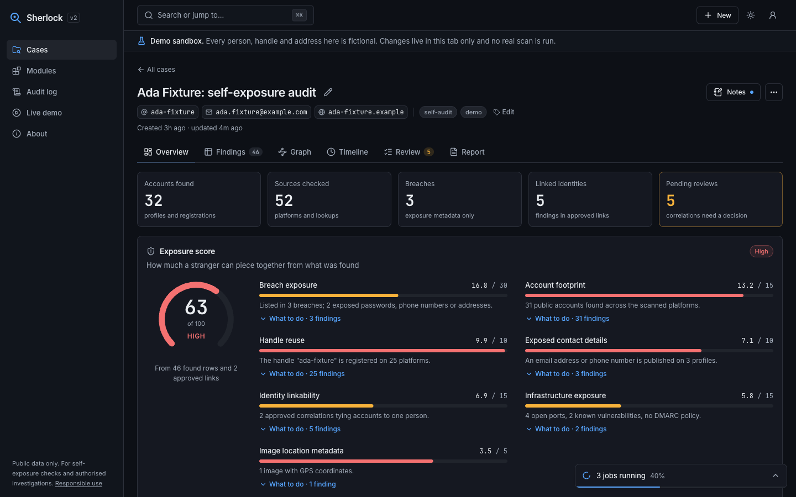
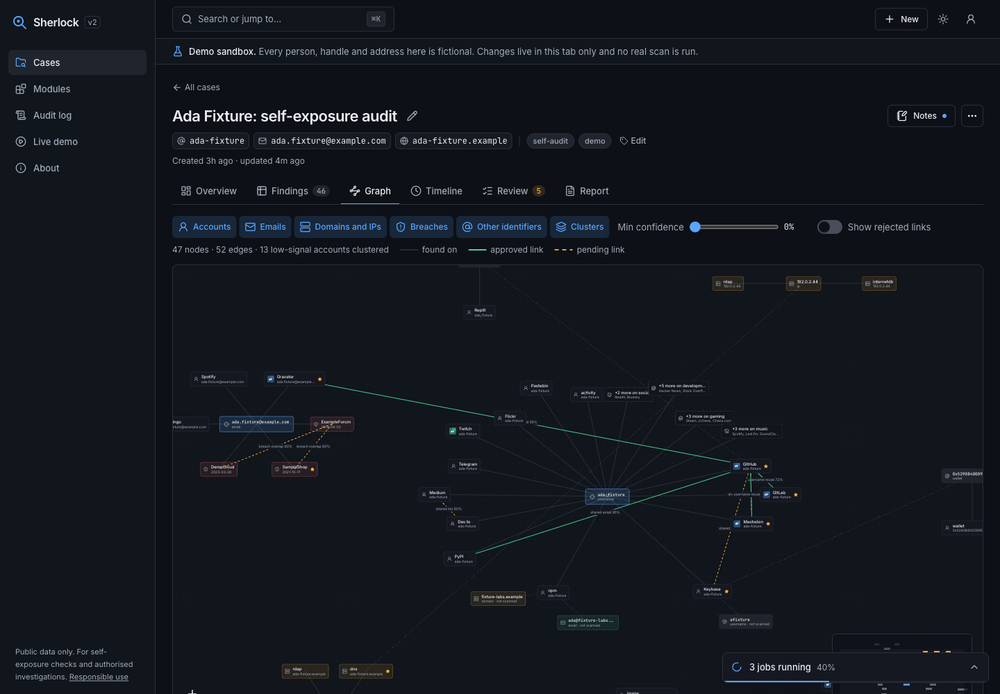
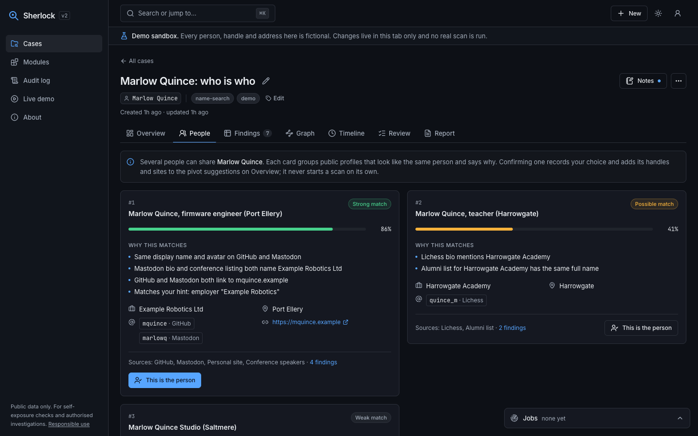

# Sherlock web

The Next.js app for Sherlock v2. Pages are client-rendered data views behind a thin server shell:
reads come straight from Supabase under row-level security (with Realtime), commands go to the
gateway. No page ever waits on the gateway during render, so a sleeping scan service cannot break it.

## Environment

Copy `.env.example` to `.env.local`.

| Variable | Purpose |
|---|---|
| `NEXT_PUBLIC_SUPABASE_URL` | Supabase project URL (reads, auth, Realtime) |
| `NEXT_PUBLIC_SUPABASE_ANON_KEY` | Supabase anon key |
| `NEXT_PUBLIC_API_URL` | Gateway base URL for commands (default `http://localhost:8000`) |
| `NEXT_PUBLIC_FIXTURES` | `1` serves everything from the bundled fictional demo case |

If the Supabase variables are missing the app shows a banner and falls back to fixture data.

## Scripts

| Script | What it does |
|---|---|
| `npm run dev` | Dev server |
| `npm run build` / `npm start` | Production build and server |
| `npm run lint` | ESLint (flat config, Next + TypeScript rules) |
| `npm run typecheck` | `tsc --noEmit` |
| `npm test` | Vitest + Testing Library |
| `npm run format` | Prettier |

## Fixture mode

```bash
NEXT_PUBLIC_FIXTURES=1 npm run dev
```

Every screen then works with no backend. The data layer has one interface, `DataSource`
(`lib/data/types.ts`), with two implementations: `lib/data/supabase.ts` (Supabase + gateway) and
`lib/data/fixtures/` (in memory). The fixture source accepts every command, simulates job progress
with timers and emits the same change events as Supabase Realtime, so the UI code path is identical.
The `/demo` route always uses it, whatever the environment.

All fixture data is fictional: the handle `ada-fixture`, the name-search subject "Marlow Quince",
reserved `.example` domains, RFC 5737 addresses. Fixture mode also scores exposure locally
(`lib/data/fixtures/exposure.ts`) so the Overview card reacts to scans and review decisions.

## Screenshots

| Cases | Overview |
|---|---|
|  |  |
| **Graph** | **Review** |
|  |  |
| **People (name search)** | |
|  | |

## Gateway calls

All from the browser with `Authorization: Bearer <Supabase access token>`, retried with backoff
while the service wakes (a "Waking the scan service…" notice appears after 3 s).

| Call | Used by |
|---|---|
| `GET /modules` | Modules page (falls back to the bundled catalogue) |
| `POST /cases`, `PATCH /cases/{id}`, `DELETE /cases/{id}` | New investigation, case menu |
| `POST /cases/{id}/scan` (`hints` for `type: "name"`) | Targets, pivots, scan form |
| `POST /cases/{id}/jobs/{job}/cancel`, `POST /cases/{id}/wake` | Jobs panel, stuck-job wake (every 20 s at most) |
| `POST /cases/{id}/findings/{fid}/curate`, `POST /correlations/{id}/review` | Findings star, Review |
| `GET /cases/{id}/report` | Report tab |
| `GET /cases/{id}/exposure` | Exposure card on Overview |
| `GET /cases/{id}/candidates`, `POST /cases/{id}/candidates/{cid}/confirm` | People tab (404 shows "not available yet") |

## Layout

```
app/                  routes (thin server shells) + error / not-found / loading
components/ui         shadcn/Radix primitives
components/shell      app shell, command palette, account menu, banners
components/cases      cases list and the New investigation dialog
components/workspace  case workspace: overview (exposure), people, findings, graph, timeline,
                      review, report, jobs
lib/types.ts          mirrors packages/core/sherlock_core/models.py
lib/data              DataSource interface, Supabase and fixture implementations, gateway client
lib/query             TanStack Query hooks, mutations and Realtime cache patching
lib/graph             graph model + deterministic radial layout
lib/finding-extras.ts parsers for module-specific finding shapes (DNS, services, wallet, image,
                      activity); unknown keys fall back to a generic key/value view
```
